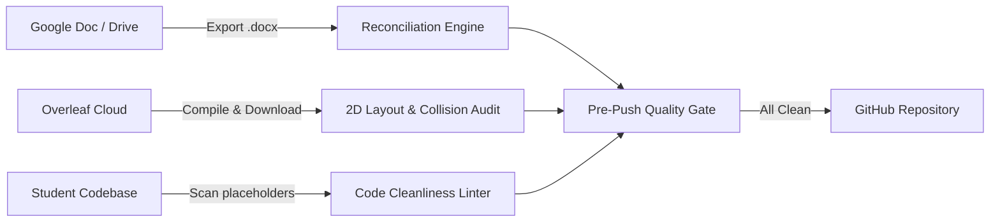

# Academic LaTeX CI (`academic-latex-ci`)

Automated quality control, typographical collision auditing, and multi-surface synchronization for academic papers, theses, and university laboratory reports.

---

## Highlights

- **2D Character Bounding-Box Collision Detection**: Parses compiled PDF character coordinates via `pypdfium2` to detect vertical line overlapping, negative space collisions, and margin overflow.
- **Bi-Directional Parity Audit**: Compares Google Docs (`.docx`) against LaTeX (`.tex`) sources word-for-word and validates metadata symmetry (e.g., verifying that teacher/advisor fields are not hallucinated on cover pages).
- **Academic Code Cleanliness Gate**: Scans student repository code before submission to flag residual placeholders, dummy telemetry values (such as hardcoded floats), and unfinished `TODO` markers.
- **Automated Pre-Push Gate**: Installs `.githooks/pre-push` to reject commits automatically if any quality check fails.
- **Overleaf Cloud Integration**: Triggers remote project compilation and pulls verified PDF artifacts.

---

## Quickstart

### 1. Installation

```bash
git clone https://github.com/eneekoruiz/academic-latex-ci.git
cd academic-latex-ci
pip install -e .
```

### 2. Configure Git Hooks in any Project

Navigate to your thesis or academic report workspace and run:

```bash
academic-ci init
```

This binds `git config core.hooksPath .githooks` so that subsequent `git push` attempts run full validation automatically.

### 3. Run Manual Verification

```bash
academic-ci verify --pdf overleaf_downloaded.pdf --docx reference.docx --tex-dir .
```

---

## Verification Pipeline



---

## Acknowledgments & Prior Art

The Overleaf communication protocol in this toolkit builds upon concepts and session-handling mechanisms originally introduced in community Overleaf-bridge utilities. This project expands those foundations into a full Continuous Integration suite focused on layout geometry and academic validation.
